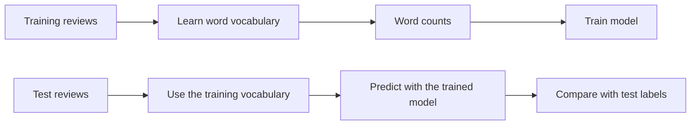

Now we want to know how customers feel. That's what **sentiment analysis** tries to do.

One difficulty is that a positive word doesn't necessarily mean a positive review.

> *"Great, another broken bottle. Exactly what I needed."*

## Try a rule first

We could write down a few positive and negative words, then count how many appear in a review.

### Example

```python exec="on" source="above" result="text" session="review-rules"
positive_words = ["love", "great", "good", "perfect"]
negative_words = ["broken", "bad", "awful", "expensive"]

def sentiment_rule(text):
    words = text.lower().replace(".", "").replace("!", "").replace(",", "").split()
    score = 0
    for word in words:
        if word in positive_words:
            score += 1
        if word in negative_words:
            score -= 1

    if score > 0:
        return "positive"
    if score < 0:
        return "negative"
    return "unclear"

for text in ["I love it!", "Awful and expensive.", "Not good."]:
    print(text, "->", sentiment_rule(text))
```

This uses lists, a function, a loop, and conditions from the [Python crash course](../preparing_data/python_crash_course.md). Here, `.lower()` lowercases a Python string, `.replace(...)` replaces some characters, and `.split()` splits it on whitespace. The punctuation handling is deliberately basic.

### Exercise: break the rule

Before running the function, predict its output for each sentence:

```python
test_reviews = [
    "Not good.",
    "Not bad!",
    "Great, another broken bottle.",
    "Love the product, awful delivery.",
    "Would buy again.",
]

# TODO: loop through test_reviews and print the rule's prediction
```

Find at least two problems. Change the word lists or add a condition to fix one of them, then try to write a new sentence that breaks your fix.

??? question "What does a score of zero mean?"

    It could mean no recognised words, a balance of positive and negative words, or something else the rule missed. **It doesn't prove that a review is neutral.**

## Define what the model should learn

A classifier needs examples **and labels**. We already have star ratings, so we'll use them to create a target:

| Rating | Training label |
| --- | --- |
| 1 or 2 stars | `negative` |
| 3 stars | Left out of this exercise |
| 4 or 5 stars | `positive` |

Three-star reviews can be mixed, neutral, or mildly positive or negative. We're leaving them out to keep our first model simple, **not because they don't matter**.

### Example

Create a new Python file called `sentiment_analysis.py` in the same project folder as `product_reviews.csv`. This block reads the data again, so it doesn't depend on running the previous page's script.

```python exec="on" source="above" result="text" session="review-model" workdir="src/data_analytics_and_AI/data"
import polars as pl

reviews = pl.read_csv("product_reviews.csv")

labeled_reviews = (
    reviews.filter(pl.col("rating") != 3)
    .with_columns(
        sentiment=pl.when(pl.col("rating") <= 2)
        .then(pl.lit("negative"))
        .otherwise(pl.lit("positive"))
    )
)

print(labeled_reviews.group_by("sentiment").len().sort("sentiment"))
```

`pl.when(...).then(...).otherwise(...)` is a column (or **vectorized**) version of `if` / `else`. `pl.lit(...)` tells Polars we're supplying a value, here a text label.

### Exercise

- Calculate the share of positive reviews in `labeled_reviews`.
- What accuracy would we get by predicting **positive for every review**?

## Turn text into numbers

In the previous session, the model received numerical features. We need numbers here too.

A simple approach is **bag of words**: create one column per word and count its occurrences in each review. For example:

| Review | good | delivery | bad |
| --- | --- | --- | --- |
| good delivery | 1 | 1 | 0 |
| bad delivery | 0 | 1 | 1 |
| good good | 2 | 0 | 0 |

The model can learn which words tend to go with which label. The basic version loses word order: `"not good"` and `"good not"` have the same counts.

### Example

Scikit-learn's [`CountVectorizer`](https://scikit-learn.org/stable/modules/generated/sklearn.feature_extraction.text.CountVectorizer.html) does this transformation for us. By default, it lowercases text and extracts tokens of at least two characters.

```python exec="on" source="above" result="text" session="review-model"
from sklearn.feature_extraction.text import CountVectorizer

vectorizer = CountVectorizer()
tiny_texts = ["good delivery", "bad delivery", "good good"]
word_matrix = vectorizer.fit_transform(tiny_texts)

print(vectorizer.get_feature_names_out())
print(word_matrix.toarray())
```

- `.fit_transform(...)` learns the vocabulary and creates the number table.
- `.get_feature_names_out()` gives the column names, in the same order as the numbers.
- `.toarray()` lets us print this tiny example as an ordinary array. For a large dataset, keep the efficient **sparse** representation, which avoids storing all those zeros.

### Exercise

Add `"not good delivery"` to `tiny_texts`. Before running the updated example below, predict how the vocabulary and matrix will change. Then find the `"not"` column and explain the last row of the matrix.

```python exec="on" source="above" result="text" session="review-model"
tiny_texts = ["good delivery", "bad delivery", "good good", "not good delivery"]
word_matrix = vectorizer.fit_transform(tiny_texts)

print(vectorizer.get_feature_names_out())
print(word_matrix.toarray())
```

Then transform a new sentence **without fitting again**:

```python exec="on" source="above" result="text" session="review-model"
new_matrix = vectorizer.transform(["excellent delivery"])
print(new_matrix.toarray())
```

What happened to `"excellent"`? Why shouldn't we learn a new vocabulary every time we make a prediction?

??? tip "Hint"

    `"excellent"` wasn't in the texts used for fitting. The vectorizer ignores unknown words. The model needs the same columns, in the same order, when training and predicting.

## Split, then train

The workflow is the same as for churn. Only the features have changed: **`X` is a list of review texts**, and **`y` is the list of sentiment labels**.



### Example

```python exec="on" source="above" result="text" session="review-model"
from sklearn.model_selection import train_test_split
from sklearn.pipeline import Pipeline
from sklearn.linear_model import LogisticRegression

model_data = (
    labeled_reviews.with_columns(
        text_key=pl.col("review_text")
        .str.to_lowercase()
        .str.replace_all(r"[^a-z0-9\s]", "")
        .str.replace_all(r"\s+", " ")
        .str.strip_chars()
    )
    .unique("text_key", keep="first", maintain_order=True)
)

X = model_data["review_text"].to_list()
y = model_data["sentiment"].to_list()

X_train, X_test, y_train, y_test = train_test_split(
    X, y, test_size=0.25, random_state=42, stratify=y
)

model = Pipeline([
    ("words", CountVectorizer()),
    ("classifier", LogisticRegression()),
])

model.fit(X_train, y_train)
print(f"Training reviews: {len(X_train)}")
print(f"Test reviews: {len(X_test)}")
```

The dataset repeats review wording. `text_key` ignores case, punctuation, and extra whitespace so we can remove those duplicates before splitting. The model still receives the original text. This makes the test more useful than testing on copies of training reviews, although similar sentences remain.

`random_state=42` makes the split repeatable, and `stratify=y` keeps approximately the same label proportions in training and testing. Removing duplicates also changes the positive share from about 71.5% to 61.5%, so the test baseline differs from the earlier exercise.

The `Pipeline` learns the vocabulary **only from training reviews**, then uses that vocabulary for test reviews. This avoids letting test data influence the features we learn.

!!! warning "Keep the answer out of the features"

    Our label comes from `rating`. Feeding `rating` into the model would give away the answer. Here, the **only input is the review text**: no rating, customer ID, or product ID.

## Evaluate the classifier

Accuracy is useful, but we want to **flag unhappy reviews**. So we'll treat `"negative"` as the class we're trying to detect.

### Example

```python exec="on" source="above" result="text" session="review-model"
from sklearn.dummy import DummyClassifier
from sklearn.metrics import accuracy_score, precision_score, recall_score

baseline = DummyClassifier(strategy="most_frequent")
baseline.fit(X_train, y_train)

y_pred = model.predict(X_test)
baseline_pred = baseline.predict(X_test)

print(f"Baseline accuracy: {accuracy_score(y_test, baseline_pred):.1%}")
print(f"Model accuracy: {accuracy_score(y_test, y_pred):.1%}")
print(f"Negative precision: {precision_score(y_test, y_pred, pos_label='negative', zero_division=0):.1%}")
print(f"Negative recall: {recall_score(y_test, y_pred, pos_label='negative', zero_division=0):.1%}")
```

=== "Precision"

    $$
    \text{Precision} = \frac{TP}{TP + FP}
    $$

    - Of the reviews flagged as `negative`, what proportion actually have a negative test label?
    - High precision helps when the team can read only a few flagged reviews.

=== "Recall"

    $$
    \text{Recall} = \frac{TP}{TP + FN}
    $$

    - Of the reviews with a negative test label, what proportion did we flag as `negative`?
    - High recall helps when missing a complaint is costly.

`pos_label="negative"` tells scikit-learn which label to focus on. Here, TP counts correctly flagged negative reviews, FP counts positive reviews incorrectly flagged as negative, and FN counts negative reviews we missed. The name of the parameter doesn't mean we have to focus on happy customers!

### Exercise

Create a table containing the test text, actual label, and prediction, then print up to five misclassified reviews.

```python exec="on" source="above" result="text" session="review-model"
test_results = pl.DataFrame({
    "review_text": X_test,
    "actual": y_test,
    "predicted": y_pred,
})

mistakes = test_results.filter(pl.col("actual") != pl.col("predicted"))
print(mistakes)
print(mistakes[0, "review_text"])
```

- Is this mistakean obvious failure, or could the label be debatable?
- If the model makes no mistakes, what about our dataset could explain that?
- The team can read only a few flagged reviews per day. Would you focus on precision or recall? What if reading reviews is cheap and missing complaints is costly?

??? tip "Same tradeoff as in the churn session"

    With very limited reading capacity, precision helps avoid wasting it. When missing complaints is the bigger concern, recall matters more.

## New reviews

Now we have a model that makes predictions for us. Let's try a few sentences, then check which words the trained model knows:

```python exec="on" source="above" result="text" session="review-model"
print(model.predict(["this product is bad"]))
print(model.predict(["I just love this product"]))
print(model.predict(["this is too expensive"]))
```

Let's now use 24 fictional challenge reviews written for this activity. Click **Download data** in the table below and save `review_challenge.csv` in your Positron project folder.

<csv-table src="../data/review_challenge.csv" caption="Customer reviews" page-size="6" download="review_challenge.csv"></csv-table>


### Example

```python exec="on" source="above" result="text" session="review-model" workdir="src/data_analytics_and_AI/data"
challenge = pl.read_csv("review_challenge.csv")
challenge = challenge.with_columns(
    prediction = model.predict(challenge["review_text"].to_list())
)

for row in challenge.head(6).to_dicts():
    print(row["review_id"], "Prediction:", row["prediction"])
    print(row["review_text"], "\n")
```

For the exercise, use `for row in challenge.to_dicts():` to print all 24.

### Exercise

In Positron, you can easily retrieve raw texts by right clicking on `review_challenge.csv` > `Open with` > `Text Editor`.

- Read the challenge reviews and write your own labels: `positive`, `negative`, or `mixed_or_unclear`.
- Compare your labels with the classifier's predictions. Find a case where forcing a binary answer is a problem.
- Add two reviews of your own: one clearly negative without a word from our negative list, and one sarcastic review. Predict with `model.predict([your_text])`.
- Would you let this system automatically send a reply to a customer? Explain what you'd check first.

??? info "Going further: pairs of words"

    A pair of consecutive words is called a **bigram**. `CountVectorizer(ngram_range=(1, 2))` uses single words and pairs, so `"not good"` can become its own feature.

    Create a second pipeline with that setting and compare predictions on your own examples.

