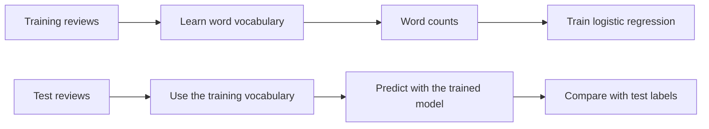

Now we want to know how customers feel. That's what **sentiment analysis** tries to do.

The main thing that makes this thing complicated is that positive words != positive review.

> *"Great, another broken bottle. Exactly what I needed."*

## Try a rule first

We could write down a few positive and negative words, then count how many appear in a review.

### Example

```python exec="on" source="above" result="text" session="review-rules"
positive_words = ["love", "great", "good", "perfect"]
negative_words = ["broken", "bad", "awful", "expensive"]

def sentiment_rule(text):
    words = text.lower().replace(".", "").replace("!", "").replace(",", "").split()
    score = 0
    for word in words:
        if word in positive_words:
            score += 1
        if word in negative_words:
            score -= 1

    if score > 0:
        return "positive"
    if score < 0:
        return "negative"
    return "unclear"

for text in ["I love it!", "Awful and expensive.", "Not good."]:
    print(text, "->", sentiment_rule(text))
```

This uses lists, a function, a loop, and conditions from the [Python crash course](../preparing_data/python_crash_course.md). Here, `.lower()` lowercases a Python string, `.replace(...)` replaces some characters, and `.split()` splits it on whitespace. The punctuation handling is deliberately basic.

### Exercise: break the rule

Before running the function, predict its output for each sentence:

```python
test_reviews = [
    "Not good.",
    "Not bad!",
    "Great, another broken bottle.",
    "Love the product, awful delivery.",
    "Would buy again.",
]

# TODO: loop through test_reviews and print the rule's prediction
```

Find at least two problems. Change the word lists or add a condition to fix one of them, then try to write a new sentence that breaks your fix.

??? question "What does a score of zero mean?"

    It could mean no recognised words, a balance of positive and negative words, or something else the rule missed. **It doesn't prove that a review is neutral.**

## Define what the model should learn

A classifier needs examples **and labels**. We already have star ratings, so we'll use them to create a target:

| Rating | Training label |
| --- | --- |
| 1 or 2 stars | `negative` |
| 3 stars | Left out of this exercise |
| 4 or 5 stars | `positive` |

Three-star reviews can be mixed, neutral, or mildly positive or negative. We're leaving them out to keep our first model simple, **not because they don't matter**.

### Example

Create a new Python file. This block reads the data again, so you can also start this page in a separate script.

```python exec="on" source="above" result="text" session="review-model"
import polars as pl

reviews = pl.read_csv("src/data_analytics_and_AI/data/product_reviews.csv")

labeled_reviews = (
    reviews.filter(pl.col("rating") != 3)
    .with_columns(
        sentiment=pl.when(pl.col("rating") <= 2)
        .then(pl.lit("negative"))
        .otherwise(pl.lit("positive"))
    )
    .group_by("sentiment").len()
)

print(labeled_reviews)
```

`pl.when(...).then(...).otherwise(...)` is a column (or **vectorized**) version of `if` / `else`. `pl.lit(...)` tells Polars we're supplying a value, here a text label.

### Exercise

- Calculate the share of positive reviews in `labeled_reviews`.
- What accuracy would we get by predicting **positive for every review**?

## Avoid testing on copies of training reviews

Our dataset repeats sentences. If `"LOVE IT!!!"` is in training and `"love it"` is in testing, the test isn't very challenging.

We'll remove repeated versions of the same wording before splitting. This key ignores casing, punctuation, and extra whitespace; we'll still feed the **original text** to the model.

You can run this preparation block as provided. The main idea is to avoid testing the model on copies of reviews it has already seen.

```python exec="on" source="above" result="text" session="review-model"
model_data = (
    labeled_reviews.with_columns(
        text_key=pl.col("review_text")
        .str.to_lowercase()
        .str.replace_all(r"[^a-z0-9\s]", "")
        .str.replace_all(r"\s+", " ")
        .str.strip_chars()
    )
    .unique(subset="text_key", maintain_order=True)
)

print(f"Before removing repeated wording: {labeled_reviews.height}")
print(f"After: {model_data.height}")
```

!!! warning

    This removes duplicates according to our key, but reviews with an added phrase or a typo can still be very similar. **The test score will still be optimistic.** Removing reviews also changes their proportions, so this smaller table is for our model experiment, not for reporting customer satisfaction.

## Turn text into numbers

In the previous session, the model received numerical features. We need numbers here too.

A simple approach is **bag of words**: create one column per word and count its occurrences in each review. For example:

| Review | good | delivery | bad |
| --- | --- | --- | --- |
| good delivery | 1 | 1 | 0 |
| bad delivery | 0 | 1 | 1 |
| good good | 2 | 0 | 0 |

The model can learn which words tend to go with which label. The basic version loses word order: `"not good"` and `"good not"` have the same counts.

### Example

Scikit-learn's [`CountVectorizer`](https://scikit-learn.org/stable/modules/generated/sklearn.feature_extraction.text.CountVectorizer.html) does this transformation for us. By default, it lowercases text and extracts tokens of at least two characters.

```python exec="on" source="above" result="text" session="review-model"
from sklearn.feature_extraction.text import CountVectorizer

vectorizer = CountVectorizer()
tiny_texts = ["good delivery", "bad delivery", "good good"]
word_matrix = vectorizer.fit_transform(tiny_texts)

print(vectorizer.get_feature_names_out())
print(word_matrix.toarray())
```

- `.fit_transform(...)` learns the vocabulary and creates the number table.
- `.get_feature_names_out()` gives the column names, in the same order as the numbers.
- `.toarray()` lets us print this tiny example as an ordinary array. For a large dataset, keep the efficient **sparse** representation, which avoids storing all those zeros.

### Exercise: inspect the numbers

Add `"not good delivery"` to `tiny_texts` and run the example again. Find the `"not"` column and explain the last row of the matrix.

Then transform a new sentence **without fitting again**:

```python
new_matrix = vectorizer.transform(["excellent delivery"])
print(new_matrix.toarray())
```

What happened to `"excellent"`? Why shouldn't we learn a new vocabulary every time we make a prediction?

??? tip "Hint"

    `"excellent"` wasn't in the texts used for fitting. The vectorizer ignores unknown words. The model needs the same columns, in the same order, when training and predicting.

## Split, then train

The workflow is the same as for churn. Only the features have changed: **`X` is a list of review texts**, and **`y` is the list of sentiment labels**.



### Example

```python exec="on" source="above" result="text" session="review-model"
from sklearn.model_selection import train_test_split
from sklearn.pipeline import Pipeline
from sklearn.linear_model import LogisticRegression

X = model_data["review_text"].to_list()
y = model_data["sentiment"].to_list()

X_train, X_test, y_train, y_test = train_test_split(
    X, y, test_size=0.25, random_state=42, stratify=y
)

model = Pipeline([
    ("words", CountVectorizer()),
    ("classifier", LogisticRegression(max_iter=1000)),
])

model.fit(X_train, y_train)
print(f"Training reviews: {len(X_train)}")
print(f"Test reviews: {len(X_test)}")
```

- `random_state=42` makes the split reproducible, so we can discuss the same results.
- `stratify=y` keeps approximately the same positive/negative proportions in each set.
- The `Pipeline` learns the vocabulary **only from training reviews**, then uses that vocabulary for test reviews. This avoids letting test data influence the features we learn.

We use the logistic regression from the previous session. No need for a new classification algorithm just because the input is text.

!!! warning "Keep the answer out of the features"

    Our label comes from `rating`. Feeding `rating` into the model would give away the answer. Here, the **only input is the review text**: no rating, customer ID, or product ID.

## Evaluate the classifier

Accuracy is useful, but the team wants to **flag unhappy reviews**. So we'll treat `"negative"` as the class we're trying to detect.

### Example

```python exec="on" source="above" result="text" session="review-model"
from sklearn.dummy import DummyClassifier
from sklearn.metrics import accuracy_score, precision_score, recall_score

baseline = DummyClassifier(strategy="most_frequent")
baseline.fit(X_train, y_train)

y_pred = model.predict(X_test)
baseline_pred = baseline.predict(X_test)

print(f"Baseline accuracy: {accuracy_score(y_test, baseline_pred):.1%}")
print(f"Model accuracy: {accuracy_score(y_test, y_pred):.1%}")
print(f"Negative precision: {precision_score(y_test, y_pred, pos_label='negative', zero_division=0):.1%}")
print(f"Negative recall: {recall_score(y_test, y_pred, pos_label='negative', zero_division=0):.1%}")
```

=== "Precision"

    Among the reviews we flagged as negative, how many have a negative label?

    Low precision means the team spends time reading positive reviews by mistake.

=== "Recall"

    Among reviews with a negative label, how many did we flag?

    Low recall means we miss unhappy reviews.

`pos_label="negative"` tells scikit-learn which label to focus on. The name of the parameter doesn't mean we have to focus on happy customers!

### Exercise: read the mistakes

Create a table containing the test text, actual label, and prediction. This code is ready to use:

```python
test_results = pl.DataFrame({
    "review_text": X_test,
    "actual": y_test,
    "predicted": y_pred,
})

mistakes = test_results.filter(pl.col("actual") != pl.col("predicted"))
for row in mistakes.head(5).to_dicts():
    print(row)
```

- Read up to five mistakes. Is each one an obvious failure, or could the label be debatable?
- If the model makes no mistakes, what about our dataset could explain that?
- The team can read only a few flagged reviews per day. Would you focus on precision or recall? What if reading reviews is cheap and missing complaints is costly?

??? tip "Same tradeoff as in the churn session"

    With very limited reading capacity, precision helps avoid wasting it. When missing complaints is the bigger concern, recall matters more. Neither choice makes the labels perfect.

## Try wording it hasn't seen before

A great test score on template-based reviews is nice. Let's make the task a bit less comfortable.

We've prepared **24 fictional reviews**, written separately from the generated dataset. Some are clearly positive or negative; others are mixed or don't give enough information. They aren't real customer data or a representative benchmark.

[Download review_challenge.csv](../data/review_challenge.csv){ .md-button download="review_challenge.csv" }

Put it next to `product_reviews.csv`. Keep using the trained model from above.

### Example

```python exec="on" source="above" result="text" session="review-model"
challenge = pl.read_csv("src/data_analytics_and_AI/data/review_challenge.csv")
challenge = challenge.with_columns(
    pl.Series("model_sentiment", model.predict(challenge["review_text"].to_list()))
)

for row in challenge.head(4).to_dicts():
    print(row)
```

Use `pl.read_csv("review_challenge.csv")` in your own script.

### Exercise: challenge the model

- Read the challenge reviews and write your own labels: `positive`, `negative`, or `mixed_or_unclear`. Do this before opening the suggested answers on the next page.
- Compare your labels with the classifier's predictions. Find a case where forcing a binary answer is a problem.
- Add two reviews of your own: one clearly negative without a word from our negative list, and one sarcastic review. Predict with `model.predict([your_text])`.
- Would you let this system automatically send a reply to a customer? Explain what you'd check first.

??? info "Going further: pairs of words"

    A pair of consecutive words is called a **bigram**. `CountVectorizer(ngram_range=(1, 2))` uses single words and pairs, so `"not good"` can become its own feature.

    If you finish early, create a second pipeline with that setting and compare predictions on your own examples. It can help with some phrases, but it doesn't solve sarcasm or guarantee better results.

    Treat this as exploration. If we keep changing the model based on the same test results, that test is no longer an independent final check. We'd need a separate validation set for choosing settings and an untouched test set for the final evaluation.

[Next: compare with an LLM](llm_activity.md){ .md-button .md-button--primary }
